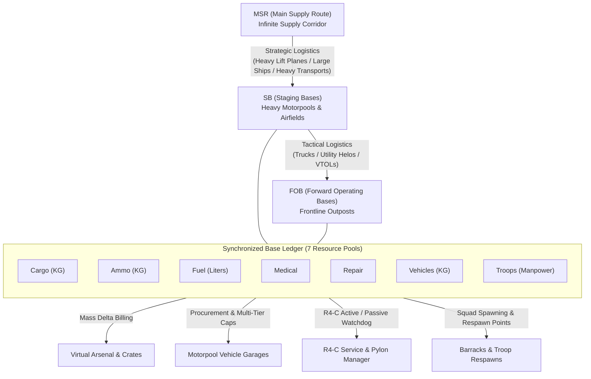

# Arma 3 Modular Logistics & Quartermaster Framework (V8)
## Comprehensive Master Feature Specification & Technical Reference (`FeatureList.md`)

---

## 1. Executive Summary & Framework Overview

The **Arma 3 Modular Logistics & Quartermaster Framework** is an enterprise-grade, server-authoritative mission architecture designed for multiplayer military simulation. It transforms Arma 3 from a static sandbox into a dynamic, persistent, economy-driven theatre of war.

At its core, the framework bridges frontline combat operations with strategic supply chain management. Every bullet fired, missile mounted, vehicle spawned, casualty redeployed, and liter of fuel consumed is backed by a living, synchronized resource economy. 

### What the Framework Accomplishes:
* **True Intermodal Logistics:** Players can physically transport bulk supplies, containers, vehicles, fuel bladders, and infantry squads across sea, air, and land corridors (Main Supply Routes $\rightarrow$ Staging Bases $\rightarrow$ Forward Operating Bases).
* **Interactive Cargo Operations:** A custom GUI manifest dialog allows drivers and crews to selectively inspect, load, and unload individual cargo objects using Vehicle-in-Vehicle (ViV) transport, flatbed winches, field cranes, or manual multi-man lifts.
* **Contextual "Spotlight" Map Intelligence:** Eliminates map clutter by dynamically managing marker transparency (`setMarkerAlphaLocal`). Combat infantry see completely clean tactical maps, logistics drivers see their active route pads highlighted at full brightness with secondary bases dimmed, and combat pilots/tankers see maintenance service stations that dynamically spotlight when their vehicle is damaged or low on ammo/fuel.
* **Autonomous Tasking Engine:** Automatically generates and tracks structured 3-tier sub-tasks (Pickup $\rightarrow$ Manifest $\rightarrow$ Delivery) with 6-digit military map grid coordinates (`mapGridPosition`), filtering assignments by vehicle role (`Strategic`, `Tactical`, `CLT`) and terrain-aware road driving distances.
* **Resource-Gated Motorpools & Virtual Arsenals:** Spawning combat vehicles or checking out equipment from the Virtual Arsenal is strictly gated by base stockpiles. Vehicle chassis mass, ammunition loadout, and fuel capacities deduct directly from base ledgers.
* **Manpower-Linked Garrisons & Respawns:** Base captures and forward redeployments consume Troop points. Running out of manpower locks out forward respawn points until supply convoys deliver fresh reinforcements.
* **Full Dedicated Server & Headless Client Optimization:** Built strictly around Bohemia Interactive locality rules, utilizing server-authoritative accounting, client-local UI rendering, JIP-safe broadcasts, and zero polling loops.

---

## 2. Detailed Feature Breakdown by Subsystem

---

### Subsystem A: Interactive Cargo Manifest & Selective Supply Loading

Replaces clunky script actions with a modern, high-fidelity cargo management suite integrating Bohemia's native Vehicle-in-Vehicle (ViV) engine with physical field equipment.

* **Dedicated Cargo Manifest GUI Dialog (`qm_manifestMenu.hpp`, IDD 5500):**
  * Opens via scroll-wheel action `[CARGO MANIFEST] Selective Supply Loading` on any authorized logistics vehicle or ViV carrier.
  * **Dual-Pane Interface:** Real-time side-by-side comparison displaying:
    1. **Internal Transport Capacity:** Current cargo count, ViV cargo mass, and total physical cargo space.
    2. **Surrounding Zone Inventory:** Scans a 25-meter perimeter around the vehicle for all loadable crates, containers, pods, vehicles, and pallets.
  * **Intelligent Environment Filtering:** Distinguishes between loose cargo and non-loadable world props (terminals, arsenal crates, hangars, fences, cones, flags, and static structures are automatically filtered out).
  * **Selective Loading & Unloading:** Players click on the exact item they want loaded into or unloaded from the transport rather than suffering blind LIFO (Last-In-First-Out) stacking.
* **Comprehensive Field Loading Capabilities (`logisticsFieldLoadingTemplate.sqf`):**
  * **Strict Scoping to Cargo Manifest GUI:** Custom field capability rules (weight limits, winches, cranes, team lifts) are strictly evaluated inside the interactive Cargo Manifest GUI (`fn_manifestLoadExecute.sqf`). Native Arma 3 engine loading (scroll-wheel ViV actions), third-party mods (Drongo's DYEL, Boxloader, ACE3 cargo), and system-automated spawning/loading operate 100% unrestricted with zero interference or force-ejection.
  * **Base Loading Zone:** Vehicles parked inside official base loading zones or near base infrastructure can freely load and unload supplies.
  * **Flatbed Winch:** Vehicles equipped with container winches (e.g. HEMTT Flatbed) can pull Huron containers up ramps in austere field conditions.
  * **Field Crane Support:** Heavy trucks equipped with hydraulic cranes (e.g. RHS M1084, KamAZ Crane) can lift heavy containers, vehicles, and pallets anywhere on the map.
  * **Multi-Man Lift:** Ground infantry can collaborate to manually lift medium supplies (121 - 250 lbs) in austere field conditions when at least 2 players are within 12 meters of the cargo. Light cargo ($\le 120$ lbs) can be loaded anywhere by a single player; heavy cargo ($> 250$ lbs) requires a base loading zone or vehicle crane.
* **Full Multi-Modal ViV Integration:**
  * Uses engine commands `canVehicleCargo`, `setVehicleCargo`, and `getVehicleCargo`.
  * Fully supports internal drive-on loading (boats onto Destroyer racks, quad bikes/small vehicles into cargo planes, crates into container trucks).
  * External slingloading fallback for heavy cargo helicopters (Huron, Taru, Mohawk) with dynamic deck snapping.

---

### Subsystem B: Contextual "Spotlight" Map Marker Hierarchy (Option 3)

Maintains maximum situational awareness for drivers and pilots while completely freeing combat infantry from logistics clutter.

* **Dynamic Client-Side Alpha Scaling (`setMarkerAlphaLocal`):**
  * Operates 100% on the local player machine with zero network packet overhead.
  * Preserves world marker coordinates (`getMarkerPos` remains fully functional for navigation and waypoints).
* **Infantry on Foot (`vehicle player == player`):**
  * All `Pickup_*`, `Dropoff_*`, `Service_*`, and `Area_*` zone markers are set to **`0%` alpha (completely hidden)**.
  * Combat soldiers, tankers, and snipers look at a 100% clean tactical map without dozens of colored circles and icons cluttering bases.
* **Logistics Drivers (Mounted in Authorized Transport):**
  * **Overview Mode (No Active Route):** All logistics pad icons display at **`100%` alpha** and area trigger boundaries display at **`25%` alpha** so drivers have complete global awareness of the logistics network.
  * **Active Route Mode (Locked Task / Transit):**
    * **Active Assigned Route Pads (Assigned Origin Pickup & Destination Dropoff):** Spotlighted at full brightness (**`100%` / `1.0`** for icons, **`0.45`** for area boundary boxes).
    * **Secondary / Alternative Logistics Pads (All other bases across Stratis):** Dimmed down to subtle opacity (**`25%` / `0.25`** for icons, **`0.10`** for area boundary boxes). Drivers instantly see alternative emergency divert dropoff locations without losing focus on their main objective.
  * **Delivery / Task Reset Transition:** Automatically returns all logistics markers to overview mode upon cargo delivery.
* **Master Base Identifiers (`SB_Main`, `SB_Carrier`, `FOB_*`, `MSR`):**
  * Permanently visible to all players at **`100%` (`1.0`) alpha** with clean, human-readable name labels.
  * Pad markers have their text stripped (`setMarkerText ""`), replacing walls of text with clean MIL-STD icons.

---

### Subsystem C: Persistent Vehicle Service Pad System & Dynamic Combat Distress Spotlighting

Ensures that combat vehicle operators and pilots always know where to repair, refuel, and rearm, while providing dynamic emergency guidance when damaged.

* **Persistent Baseline Visibility for Any Vehicle:**
  * The moment any player enters **any** vehicle (Jet, Attack Helicopter, Main Battle Tank, APC, Boat, or Transport), all base R4-C Service pad icons (`Service_*`) become visible at **`50%` (`0.50`) alpha** (with area boundaries at **`20%` (`0.20`) alpha**).
  * Combat aircraft and armor operators remain aware of nearby maintenance airfields and repair yards without logistics crate clutter.
* **Dynamic Combat Distress Spotlight (`100%` / `1.0` Alpha):**
  * The system continuously monitors the player's mounted vehicle:
    * **Damage Trigger:** Overall hull damage **$> 25\%$** or *any* critical subsystem (engine, main rotor, tail rotor, wings, tracks, gun barrel) damaged **$> 25\%$**.
    * **Fuel Trigger:** Fuel reserve falls **$< 50\%$**.
    * **Ammunition Trigger:** Vehicle expends **$> 50\%$** of its initial magazine ammunition.
  * **Result:** All service markers across the theatre instantly spotlight to **`100%` (`1.0`) brightness** with prominent zone borders (**`0.45`**), popping out on both the 2D Map and the GPS Minimap to guide the pilot back to friendly lines.
* **Automatic Restoration & Dismount Cleanup:**
  * Servicing the vehicle at an R4-C pad resets health, fuel, and ammo, smoothly returning markers to the `50%` baseline.
  * Dismounting onto foot immediately restores `0%` alpha for infantrymen.

---

### Subsystem D: Autonomous Logistics Tasking & Mission Routing Engine

A comprehensive client-side routing coordinator (`fn_manageLogisticsMissions.sqf`) that evaluates vehicle types, roles, and distances to guide drivers through logical supply loops.

* **Multi-Role Vehicle Priority (`logisticsVehicleRoles.sqf`):**
  * Transports are mapped to specific roles:
    * **`Strategic`:** High-capacity heavy lift (MSR $\rightarrow$ SB). Transports bulk cargo containers, vehicle crates, and fuel bladders.
    * **`Tactical`:** Medium tactical haulers (SB $\rightarrow$ FOB). Distributes sorted supplies forward to combat outposts.
    * **`CLT` (Container / Light Transport):** Short-range utility runs, base organization, and local deliveries.
  * Supports ordered role arrays (e.g. `["Strategic", "Tactical", "CLT"]` vs. `["Tactical", "CLT"]`), auto-assigning the vehicle's primary role while permitting manual selection of alternative roles in the map diary.
* **Structured 3-Tier Sub-Task Hierarchy (`BIS_fnc_setTask`):**
  * When a route is assigned, the system creates an organized parent/child task tree:
    1. **Sub-Task 1: Pickup Supplies:** Directs driver to the compatible pickup zone at the origin base with exact 6-digit military grid coordinates (`mapGridPosition`) and procedure rules (e.g., flight altitude limits or ground stop requirements). Automatically marks `SUCCEEDED` upon loading completion.
    2. **Sub-Task 2: Cargo Manifest & Securing:** Shows the loaded supply category (e.g. `Ammo`, `Fuel`, `Medical`, `Cargo`) and live securing status. Fails/resets if cargo is detached or lost prematurely in transit.
    3. **Sub-Task 3: Deliver Supplies:** Transitions to `ASSIGNED` upon loading completion, locking HUD waypoints onto the destination base dropoff zone with 6-digit grid coordinates.
    4. **Parent Route Task:** Automatically cycles to `SUCCEEDED` when all three sub-tasks finish, clearing HUD clutter and selecting the next prioritized assignment.
* **Terrain-Aware Road Driving vs. Flight Distance Routing (`logi_fnc_getRouteDistance`):**
  * **Aircraft (`Air`):** Evaluates true straight-line 3D Euclidean flight distance.
  * **Ground Vehicles (`LandVehicle`):** Queries a precomputed road-network driving matrix (e.g. Stratis road distances between bases: `SB_Main` to `CampRogain`: 3,200m, `CampMaxwell`: 4,100m, `Mike26`: 4,600m, `CampTempest`: 7,200m). Prevents ground trucks from receiving impossible routes across ocean channels or isolated cliffs.
  * **Dynamic Fallback:** Scales straight-line distance by a 1.4x winding road factor for unmapped custom maps.
* **Geographic Domain Isolation:**
  * Ground vehicles cannot receive routes to ocean-based FOBs (Destroyers or Carrier decks).
  * Naval supply vessels cannot receive routes to inland mountain FOBs.
* **Sticky Route Locking:**
  * Once cargo is loaded into a transport (`_isLoaded == true`), the assigned destination FOB is hard-locked. Even if another FOB's score drops lower while driving, the truck will not have its waypoint yanked away mid-transit.

---

### Subsystem E: Universal Dropoff Processing & Field Salvage

Provides seamless supply offloading while strictly safeguarding player-owned combat vehicles.

* **Universal Dropoff Acceptance (`fn_cargoDelivery.sqf`):**
  * Any vehicle, helicopter, boat, or player on foot can deliver supplies.
  * Unloading an internal ViV cargo object or dropping a slingloaded container inside any friendly `<BaseKey>_dropoff` trigger immediately validates the object against `SupplyScores.sqf`, credits the receiving base's resource pools, and deletes the container from the tarmac.
  * Supports alternate-base diversions: delivering supplies to an unassigned friendly base successfully credits that base and completes the delivery task.
* **Strict Vehicle Isolation Safeguard:**
  * Enforces a hard distinction between detached supply objects (crates, cargo nets, fuel bladders, containers) and drivable vehicles (`LandVehicle`, `Air`, `Ship`).
  * Drivable combat or transport vehicles entering or passing through dropoff zones are **never** automatically deleted, consumed, or despawned.
  * Vehicle salvaging is strictly restricted to intentional player actions (see Subsystem G).

---

### Subsystem F: Base Ledger Economy & Synchronized Supply Pools

The economic backbone governing all base capabilities across 7 synchronized resource categories.

| Resource Pool | Variable Name | Purpose & Consumption Mechanics |
| :--- | :--- | :--- |
| **`Cargo`** | `LogiScore_<BaseKey>_Cargo` | General supplies, building materials, and Virtual Arsenal checkout weight. Billed based on net mass changes (KG). |
| **`Ammo`** | `LogiScore_<BaseKey>_Ammo` | Ground vehicle rearming, physical ammo container servicing, aircraft pylon ordnance loading, and motorpool vehicle ammo costs. |
| **`Fuel`** | `LogiScore_<BaseKey>_Fuel` | Vehicle refueling (Liters), physical fuel bladder transfers, and motorpool vehicle fuel costs. |
| **`Medical`** | `LogiScore_<BaseKey>_Medical` | Field medical supplies and casualty treatment stockpile points. |
| **`Repair`** | `LogiScore_<BaseKey>_Repair` | Vehicle repair operations, physical tool container maintenance, and motorpool chassis maintenance costs. |
| **`Vehicles`** | `LogiScore_<BaseKey>_Vehicles` | Heavy vehicle procurement chassis points (derived from base vehicle mass in KG). |
| **`Troops`** | `LogiScore_<BaseKey>_Troops` | Manpower pool used for player respawns (1 Troop per death), AI infantry recruitment, and R4-C vehicle recrewing. |

* **Infinite Supply Origins (`MSR`):**
  * Main Supply Route bases hold `-1` in all categories, representing unlimited mainland industrial capacity. MSRs function solely as supply pickup origins and strictly disallow player respawns or combat vehicle procurement.
* **Live Briefing Diary Ledger (`qm_clientFunctions.sqf`):**
  * Continuously updates a dedicated "Logistics Stockpile Ledger" diary subject on the player's map screen, formatting values from thousands up to quintillions without scientific notation.

---

### Subsystem G: Virtual Arsenal & Armory Transactions

Transforms the Virtual Arsenal from a free "cheat menu" into a realistic, supply-limited quartermaster system.

* **Net Weight Mass Delta Accounting (`fn_equipmentTrader.sqf` & `qm_serverFunctions.sqf`):**
  * When a player opens the Virtual Arsenal at a `<BaseKey>_Arsenal` or `<BaseKey>_Terminal` object, their starting equipment mass (`loadAbs player`) is recorded.
  * When closing the Arsenal, the net weight difference is calculated:
    $$\text{Mass Delta} = \text{Ending Mass} - \text{Starting Mass}$$
    $$\text{KG Billed} = \text{round}(\text{Mass Delta} \times 0.1)$$
  * **Sufficient Stockpile:** The net KG difference is deducted from `LogiScore_<BaseKey>_Cargo`. Returning gear refunds Cargo points back to the base.
  * **Insufficient Stockpile:** If the base lacks sufficient Cargo points, the transaction is rejected, and the player's previous loadout is restored via `setUnitLoadout`.
* **Faction & Terrain Whitelisting (`virtualArsenalTemplate.sqf`):**
  * Arsenal contents are filtered by player side (`BLUFOR`, `OPFOR`, `Independent`) and the current island biome (`Desert`, `Woodland`, `Mediterranean`, `Jungle`) determined via `worldName`.
* **Physical Crate Population (`qm_serverGarrisonManager.sqf`):**
  * Physical terminal crates are filled with matching equipment so players who prefer physical inventory browsing can take weapons and magazines directly.

---

### Subsystem H: Motorpool Vehicle Procurement & 3D Object Garages

A complete vehicle procurement dialog (`CfgVehicleProcureMenu`, `c_vehicleTabs.sqf`, `qm_serverFunctions.sqf`) spawning assets with exact elevation and orientation.

* **Strict 3D Editor Object References (No 2D Marker Guesswork):**
  * All garages, arsenals, and spawn points use editor-placed 3D objects (e.g. `Land_HelipadEmpty_F`, `Land_Destroyer_01_Boat_Rack_01_F`) rather than 2D map markers.
  * Spawned vehicles inherit the exact 3D Above-Sea-Level (`getPosASL`) elevation and heading (`getDir`) of the object, ensuring safe spawning on Carrier flight decks, Destroyer helicopter pads, and uneven terrain.
* **Upper-Limit Pad Sizing (`XXS` through `XL`):**
  * Garages enforce vehicle size restrictions based on variable naming:
    $$\text{XXS} (1) \rightarrow \text{XS} (2) \rightarrow \text{S} (3) \rightarrow \text{M} (4) \rightarrow \text{L} (5) \rightarrow \text{XL} (6) \rightarrow \text{OPEN} (7)$$
  * Larger pads can spawn smaller vehicles (e.g. an `_XL` pad can spawn an `_S` quad bike or an `_XL` tank), but small pads cannot spawn oversized vehicles.
* **Vehicle Category Filtering:**
  * Garages can be restricted to specific domains: `_GROUND`, `_HELI` / `_HELICOPTER`, `_PLANE`, `_AIR` (both helis and planes), `_BOAT`, or universal.
* **Boat Rack Direct Deployment:**
  * Spawning a boat at a garage configured as a Destroyer Boat Rack (`Land_Destroyer_01_Boat_Rack_01_F`) automatically uses Bohemia's `setVehicleCargo` to load the boat directly into the rack.
* **Multi-Tier Vehicle Caps (`qm_vehicleCapsTemplate.sqf` & `qm_serverFunctions.sqf`):**
  * Evaluates vehicle cap limits across parent families and specific classnames (e.g. max 4 Tanks globally, max 2 Blackfish, max 6 Helicopters).
  * Automatically registers vehicles upon spawn and unregisters them upon destruction, deletion, or salvage.
* **Multi-Resource Cost Deduction:**
  * Vehicles cost a combination of `Vehicles` (chassis mass), `Ammo` (mounted armament), and `Fuel` (internal fuel capacity).

---

### Subsystem I: Garrison Barracks AI Recruitment & Manpower Respawns

Ties player respawns and AI recruitment directly to the base's living `Troops` pool.

* **Individual Unit & Full Squad Recruitment (`fn_recruiter.sqf`, `fn_recruiter_list.sqf`):**
  * Players can open the Quartermaster Control Hub to recruit individual specialists (medics, engineers, AT riflemen) or pre-built fireteams and squads.
  * Spawns units on the server at the nearest `<BaseKey>_Spawn` 3D object's exact ASL position, deducts the troop cost, and joins them into the player's group via `joinSilent`.
* **Manpower-Gated Native Player Respawns (`qm_serverRespawnManager.sqf` & `onPlayerRespawn.sqf`):**
  * Dynamic respawn positions (`BIS_fnc_addRespawnPosition`) remain active at a base only while `LogiScore_<BaseKey>_Troops >= 1`.
  * Each player respawn deducts 1 Troop point on the server (`QM_fnc_deductRespawnTroop`).
  * If a base's Troop pool hits `0`, its respawn point deactivates until reinforcements arrive.
* **Indoor Structural Barracks Placement:**
  * When a player respawns, the system scans within 40m for Cargo Houses (`Land_Cargo_House_V1_F`, `Land_Cargo_House_V3_F`). If present, the player materializes safely inside a designated interior building position.
* **Forward Redeployment Cooldown:**
  * Prevents endless FOB respawn zerging by applying a configurable redeployment timer (default 120 seconds) when spawning at forward bases.

---

### Subsystem J: R4-C Vehicle Servicing & Dynamic Aircraft Pylon Management

Complete maintenance facilities for damaged, dry, or unarmed vehicles in the field.

* **R4-C Active Service Pads (`<BaseKey>_service` triggers & `fn_executeR4CService.sqf`):**
  * **Repair:** Calculates structural damage and repairs the vehicle, billing `LogiScore_<BaseKey>_Repair`.
  * **Refuel:** Calculates missing fuel volume in liters, filling the tank and billing `LogiScore_<BaseKey>_Fuel`.
  * **Rearm:** Re-supplies all vehicle turrets and weapons, billing `LogiScore_<BaseKey>_Ammo`.
  * **Recrew:** Scans for empty crew seats (driver, gunner, commander, turrets), spawns competent AI crewmen on the server, and joins them into the player's group, billing 1 Troop per crewman.
* **Passive Physical Service Containers (`qm_supplyPhysicalController.sqf`):**
  * Physical objects named `<BaseKey>_fuel_*`, `<BaseKey>_ammo_*`, or `<BaseKey>_repair_*` passively service vehicles within 20m.
  * The server watchdog tracks resource consumption and sets container cargo to `0` if the base stockpile runs out.
* **Aircraft Pylon Configuration Dialog (`fn_pylonManager.sqf`, `qm_pylonMenu.hpp`):**
  * Available to pilots within 40m of a service trigger or ammo object.
  * Allows customizing every aircraft pylon hardpoint (missiles, bombs, rocket pods, gun pods), assigning pilot vs. gunner turret control, setting ammo counts, and changing aircraft paint schemes.
  * Calculates the net weight delta of the munitions in KG and deducts or refunds `LogiScore_<BaseKey>_Ammo`.

---

## 3. Native Arma 3 Engine Functions vs. Custom Framework Functions

The framework seamlessly combines native Bohemia Interactive engine commands with bespoke server-authoritative scripts.

### Native Engine Commands Utilized
* **Vehicle-in-Vehicle (ViV):** `canVehicleCargo`, `setVehicleCargo`, `getVehicleCargo`, `enableVehicleCargo`.
* **3D Geometry & Raycasting:** `getPosASL`, `setPosASL`, `modelToWorld`, `lineIntersectsSurfaces`, `boundingBoxReal`.
* **Map & GPS Graphics:** `setMarkerAlphaLocal`, `createMarker`, `setMarkerColor`, `setMarkerType`, `setMarkerShape`, `setMarkerSize`, `setMarkerBrush`, `setMarkerDir`.
* **Tasks & Waypoints:** `BIS_fnc_taskCreate`, `BIS_fnc_taskSetState`, `BIS_fnc_taskSetDestination`, `BIS_fnc_taskSetDescription`, `BIS_fnc_taskSetCurrent`, `BIS_fnc_taskReal`, `mapGridPosition`.
* **Vehicle & Inventory Management:** `loadAbs`, `setUnitLoadout`, `getUnitLoadout`, `damage`, `fuel`, `magazinesAmmo`, `setPylonLoadout`, `setAmmoOnPylon`, `createVehicleCrew`, `moveInCargo`.
* **Multiplayer Networking:** `remoteExec`, `publicVariable`, `addMPEventHandler`, `addMissionEventHandler`.

### Custom Framework Architecture Functions
* **Logistics Task & Routing:** `logi_fnc_updateMarkerSpotlight`, `logi_fnc_updateRouteTasks`, `logi_fnc_getRouteDistance`, `logi_fnc_getCompatiblePickupTrigger`, `logi_fnc_getDropoffLocation`, `logi_fnc_clearAllLogiTasks`, `logi_fnc_deleteRouteSubTasks`, `createClientLogiTasks`, `logi_fnc_formatPoints`.
* **Cargo Manifest & Mechanics:** `QM_fnc_manifestMenuOpen`, `QM_fnc_manifestMenuPopulate`, `QM_fnc_manifestLoadExecute`, `QM_fnc_manifestUnloadExecute`, `QM_fnc_initVehicleCargoRules`, `LOGI_fnc_handlePickupTrigger`.
* **Server Quartermaster Engine:** `QM_fnc_processGarageSpawn`, `QM_fnc_serverVehicleSale`, `QM_fnc_processInventoryTransaction`, `QM_fnc_serverCreateLocalUnit`, `QM_fnc_serverCreateLocalGroup`, `QM_fnc_serverProcessR4C`, `QM_fnc_serverR4CCreateVehicleCrew`, `QM_fnc_deductRespawnTroop`.
* **Vehicle Cap Management:** `QM_CAP_fnc_checkCurrentActiveCount`, `QM_CAP_fnc_registerNewVehicle`, `QM_CAP_fnc_unregisterVehicleAsset`.
* **Facilities & Environment:** `QM_fnc_getLocationsByPrefix`, `fn_G_getTerrain`, `QM_fnc_getNearbyAmmoSource`, `QM_fnc_canOpenPylonMenu`.

---

## 4. File-by-File Workspace Reference

| File | Subsystem / Role | Primary Responsibilities |
| :--- | :--- | :--- |
| [`init.sqf`](file:///C:/Users/JSHer/OneDrive/Documents/Arma%203/missions/Mine/Testing/Logistics/Logistics%20System/init.sqf) | Master Bootloader | Base discovery, network ledger initialization, terrain classification, and script launching. |
| [`description.ext`](file:///C:/Users/JSHer/OneDrive/Documents/Arma%203/missions/Mine/Testing/Logistics/Logistics%20System/description.ext) | Mission Config | GUI dialog `#include` directives, respawn configurations, and header settings. |
| [`fn_initLogisticsTasks.sqf`](file:///C:/Users/JSHer/OneDrive/Documents/Arma%203/missions/Mine/Testing/Logistics/Logistics%20System/fn_initLogisticsTasks.sqf) | Trigger Normalizer & Markers | Normalizes legacy trigger scripts, creates server markers, and initializes Option 3 spotlight logic. |
| [`fn_manageLogisticsMissions.sqf`](file:///C:/Users/JSHer/OneDrive/Documents/Arma%203/missions/Mine/Testing/Logistics/Logistics%20System/fn_manageLogisticsMissions.sqf) | Client Tasking & HUD | 3-tier sub-task engine, road distance routing, sticky route locking, and map marker spotlight loops. |
| [`fn_spawnLoadSupply.sqf`](file:///C:/Users/JSHer/OneDrive/Documents/Arma%203/missions/Mine/Testing/Logistics/Logistics%20System/fn_spawnLoadSupply.sqf) | Supply Spawner | Deducts origin base points, spawns physical cargo, handles ViV loading, and stages slingload crates. |
| [`fn_cargoDelivery.sqf`](file:///C:/Users/JSHer/OneDrive/Documents/Arma%203/missions/Mine/Testing/Logistics/Logistics%20System/fn_cargoDelivery.sqf) | Dropoff Crediting | Validates dropped cargo against score tables, credits receiving base pools, and deletes crates. |
| [`fn_standaloneLoadingMechanic.sqf`](file:///C:/Users/JSHer/OneDrive/Documents/Arma%203/missions/Mine/Testing/Logistics/Logistics%20System/fn_standaloneLoadingMechanic.sqf) | Manifest Action Binder | Dispatches `[CARGO MANIFEST]` actions to client vehicles and provides field loading daemons. |
| [`qm_manifestMenu.hpp`](file:///C:/Users/JSHer/OneDrive/Documents/Arma%203/missions/Mine/Testing/Logistics/Logistics%20System/qm_manifestMenu.hpp) | Manifest Dialog GUI | Resource definition for the dual-pane Cargo Manifest UI (IDD 5500). |
| [`fn_manifestMenuOpen.sqf`](file:///C:/Users/JSHer/OneDrive/Documents/Arma%203/missions/Mine/Testing/Logistics/Logistics%20System/fn_manifestMenuOpen.sqf) | Manifest GUI Launcher | Opens IDD 5500 dialog and initializes perimeter scanning. |
| [`fn_manifestMenuPopulate.sqf`](file:///C:/Users/JSHer/OneDrive/Documents/Arma%203/missions/Mine/Testing/Logistics/Logistics%20System/fn_manifestMenuPopulate.sqf) | Manifest Scanner | Scans 25m perimeter, filters non-cargo props, and populates UI listboxes. |
| [`fn_manifestLoadExecute.sqf`](file:///C:/Users/JSHer/OneDrive/Documents/Arma%203/missions/Mine/Testing/Logistics/Logistics%20System/fn_manifestLoadExecute.sqf) | Manifest Load Executor | Validates zone/winch/crane/lift requirements and loads selected item via `setVehicleCargo`. |
| [`fn_manifestUnloadExecute.sqf`](file:///C:/Users/JSHer/OneDrive/Documents/Arma%203/missions/Mine/Testing/Logistics/Logistics%20System/fn_manifestUnloadExecute.sqf) | Manifest Unload Executor | Safely ejects selected cargo from internal transport space onto the ground. |
| [`qm_serverFunctions.sqf`](file:///C:/Users/JSHer/OneDrive/Documents/Arma%203/missions/Mine/Testing/Logistics/Logistics%20System/qm_serverFunctions.sqf) | Server Quartermaster API | 3D garage spawning, salvage refunds, AI recruitment, R4-C servicing, and vehicle caps. |
| [`qm_clientFunctions.sqf`](file:///C:/Users/JSHer/OneDrive/Documents/Arma%203/missions/Mine/Testing/Logistics/Logistics%20System/qm_clientFunctions.sqf) | Client Watchdogs | Terminal action binders, diary ledger refreshers, and ammo source scanners. |
| [`qm_clientActionCompiler.sqf`](file:///C:/Users/JSHer/OneDrive/Documents/Arma%203/missions/Mine/Testing/Logistics/Logistics%20System/qm_clientActionCompiler.sqf) | Action Compiler | Binds Quartermaster Hub, Virtual Arsenal, and Motorpool actions to terminal objects. |
| [`fn_equipmentTrader.sqf`](file:///C:/Users/JSHer/OneDrive/Documents/Arma%203/missions/Mine/Testing/Logistics/Logistics%20System/fn_equipmentTrader.sqf) | Virtual Arsenal Gate | Calculates net weight delta in KG and deducts/refunds base `Cargo` points upon closing. |
| [`c_vehicleTabs.sqf`](file:///C:/Users/JSHer/OneDrive/Documents/Arma%203/missions/Mine/Testing/Logistics/Logistics%20System/c_vehicleTabs.sqf) | Motorpool UI Logic | Filters spawnable vehicles by faction, biome, base tier, and 3D garage pad size (XXS-XL). |
| [`fn_executeR4CService.sqf`](file:///C:/Users/JSHer/OneDrive/Documents/Arma%203/missions/Mine/Testing/Logistics/Logistics%20System/fn_executeR4CService.sqf) | R4-C Service Actions | Dispatches Repair, Refuel, Rearm, and AI Recrew requests to the server. |
| [`fn_pylonManager.sqf`](file:///C:/Users/JSHer/OneDrive/Documents/Arma%203/missions/Mine/Testing/Logistics/Logistics%20System/fn_pylonManager.sqf) | Pylon Manager | Controls aircraft hardpoint ordnance customization and bills `Ammo` mass deltas. |
| [`qm_serverRespawnManager.sqf`](file:///C:/Users/JSHer/OneDrive/Documents/Arma%203/missions/Mine/Testing/Logistics/Logistics%20System/qm_serverRespawnManager.sqf) | Respawn Watchdog | Binds native respawn points to 3D `_Spawn` objects while base `Troops` pool $> 0$. |
| [`onPlayerRespawn.sqf`](file:///C:/Users/JSHer/OneDrive/Documents/Arma%203/missions/Mine/Testing/Logistics/Logistics%20System/onPlayerRespawn.sqf) | Respawn Handoff | Places player indoors if barracks are nearby, deducts 1 Troop, and applies FOB cooldowns. |
| [`qm_supplyPhysicalController.sqf`](file:///C:/Users/JSHer/OneDrive/Documents/Arma%203/missions/Mine/Testing/Logistics/Logistics%20System/qm_supplyPhysicalController.sqf) | Passive Supply Watchdog | Monitors physical fuel, ammo, and repair objects and deducts resource points. |
| [`SupplyScores.sqf`](file:///C:/Users/JSHer/OneDrive/Documents/Arma%203/missions/Mine/Testing/Logistics/Logistics%20System/SupplyScores.sqf) | Supply Score Matrix | Mapping of supply container classnames to their respective point categories and values. |
| [`logisticsBaseDefaults.sqf`](file:///C:/Users/JSHer/OneDrive/Documents/Arma%203/missions/Mine/Testing/Logistics/Logistics%20System/logisticsBaseDefaults.sqf) | Economy Defaults | Starting resource allocations for MSR (infinite), SB (heavy), and FOB (tactical) tiers. |
| [`logisticsVehicleRoles.sqf`](file:///C:/Users/JSHer/OneDrive/Documents/Arma%203/missions/Mine/Testing/Logistics/Logistics%20System/logisticsVehicleRoles.sqf) | Vehicle Role Config | Defines ordered role priorities (`Strategic`, `Tactical`, `CLT`) for all transport vehicles. |
| [`logisticsCargoTemplates.sqf`](file:///C:/Users/JSHer/OneDrive/Documents/Arma%203/missions/Mine/Testing/Logistics/Logistics%20System/logisticsCargoTemplates.sqf) | Cargo Spawning Matrix | Defines vehicle loadout types (ViV, Slingload, Troops) and valid supply categories. |
| [`qm_vehicleCapsTemplate.sqf`](file:///C:/Users/JSHer/OneDrive/Documents/Arma%203/missions/Mine/Testing/Logistics/Logistics%20System/qm_vehicleCapsTemplate.sqf) | Vehicle Cap Matrix | Global and family-specific concurrent vehicle asset limits. |
| [`virtualArsenalTemplate.sqf`](file:///C:/Users/JSHer/OneDrive/Documents/Arma%203/missions/Mine/Testing/Logistics/Logistics%20System/virtualArsenalTemplate.sqf) | Arsenal Whitelist | Whitelist of weapons, magazines, items, and backpacks by faction and map biome. |
| [`spawnableVehicleTemplate.sqf`](file:///C:/Users/JSHer/OneDrive/Documents/Arma%203/missions/Mine/Testing/Logistics/Logistics%20System/spawnableVehicleTemplate.sqf) | Motorpool Catalog | Complete catalog of procurable vehicles with pad size ratings and multi-resource costs. |
| [`spawnableInfantryTemplate.sqf`](file:///C:/Users/JSHer/OneDrive/Documents/Arma%203/missions/Mine/Testing/Logistics/Logistics%20System/spawnableInfantryTemplate.sqf) | Barracks Catalog | Individual infantry classes and full squad templates with troop costs. |
